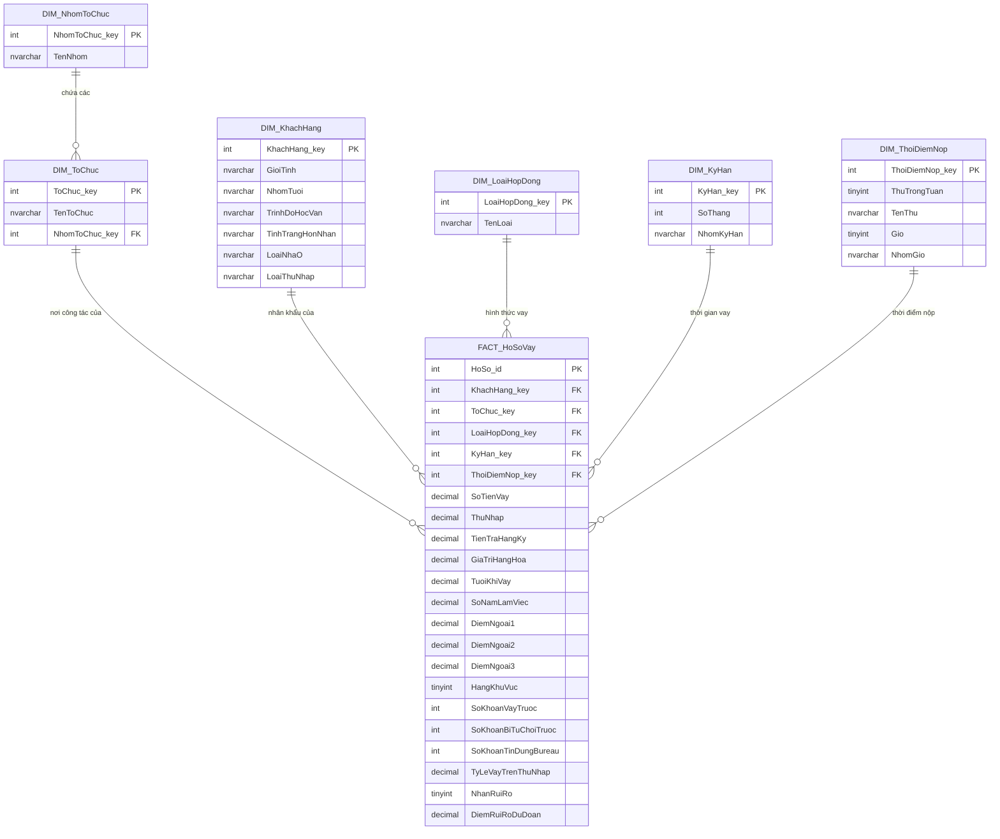

# THIẾT KẾ MÔ HÌNH DỮ LIỆU ĐA CHIỀU (STAR & SNOWFLAKE SCHEMA)
## Đề tài: Kho dữ liệu Phân tích Rủi ro Tín dụng (CO4031 — Credit Risk DW)

---

### 1. Giới thiệu Kiến trúc Lược đồ (Schema Architecture)

Trong hệ thống Kho dữ liệu CO4031, mô hình dữ liệu được thiết kế kết hợp giữa **Star Schema** (Lược đồ hình sao) và **Snowflake Schema** (Lược đồ bông tuyết) nhằm tối ưu hóa giữa hiệu năng truy vấn phân tích (OLAP) và tính chuẩn hóa dữ liệu phân cấp:

- **Bảng Fact (`FACT_HoSoVay`)**: Nằm ở vị trí trung tâm, lưu trữ các sự kiện nộp hồ sơ vay tín dụng và các số đo định lượng (Measures).
- **Mức độ chi tiết (Fact Grain)**: Mỗi dòng đại diện cho đúng **1 hồ sơ đề nghị vay vốn tín dụng** (`HoSo_id` tương ứng với `SK_ID_CURR`).
- **Degenerate Dimension**: `HoSo_id` đóng vai trò vừa là khóa chính vừa là chiều suy biến (degenerate dimension) để đối chiếu nguồn.
- **Snowflake Dimension (`DIM_NhomToChuc` ➔ `DIM_ToChuc`)**: Chiều tổ chức nơi khách hàng công tác được chuẩn hóa 2 cấp (Cấp 1: Nhóm ngành lớn như Công nghiệp, Thương mại, Giáo dục, Khu vực công...; Cấp 2: Chi tiết tổ chức cụ thể). Thiết kế này giúp tiết kiệm lưu trữ và hỗ trợ phép toán OLAP **Roll-up** từ đơn vị cơ sở lên nhóm ngành vĩ mô.
- **Profile Dimension (`DIM_KhachHang`)**: Gom nhóm các thuộc tính nhân khẩu học (Giới tính, Nhóm tuổi, Trình độ học vấn, Tình trạng hôn nhân, Loại nhà ở, Nguồn thu nhập) thành một chiều hồ sơ nhằm tránh trùng lặp dữ liệu và tăng tốc độ lọc.
- **Các chiều độc lập khác**:
  - `DIM_LoaiHopDong`: Phân loại hợp đồng vay (Cash loans, Revolving loans).
  - `DIM_KyHan`: Chiều kỳ hạn suy diễn từ tỷ số `AMT_CREDIT / AMT_ANNUITY` (0 đến 120 tháng, chia theo nhóm kỳ hạn: `<=12`, `13-24`, `25-36`, `>36`, `Không xác định`).
  - `DIM_ThoiDiemNop`: Chiều thời gian gồm 168 bản ghi đại diện cho 7 ngày trong tuần × 24 giờ trong ngày (kèm nhóm khung giờ: Sáng, Chiều, Tối, Đêm).

---

### 2. Sơ đồ Quan hệ Thực thể Đa chiều (Mermaid ERD)

---

### 3. Chi tiết Thuộc tính & Kiểu dữ liệu Vật lý

| Tên Bảng | Vai trò | Khóa chính (PK) | Các cột thuộc tính chính | Ý nghĩa phân tích |
|---|---|---|---|---|
| `DIM_NhomToChuc` | Bông tuyết Cấp 1 | `NhomToChuc_key` | `TenNhom` | Hỗ trợ phân tích vĩ mô theo ngành nghề |
| `DIM_ToChuc` | Bông tuyết Cấp 2 | `ToChuc_key` | `TenToChuc`, `NhomToChuc_key` (FK) | Phân tích chi tiết rủi ro theo từng đơn vị tuyển dụng |
| `DIM_KhachHang` | Profile Dimension | `KhachHang_key` | `GioiTinh`, `NhomTuoi`, `TrinhDoHocVan`, `TinhTrangHonNhan`, `LoaiNhaO`, `LoaiThuNhap` | Lọc và phân đoạn khách hàng theo đặc điểm nhân khẩu |
| `DIM_LoaiHopDong` | Dimension | `LoaiHopDong_key` | `TenLoai` | So sánh rủi ro giữa vay tiền mặt và thẻ thấu chi |
| `DIM_KyHan` | Dimension | `KyHan_key` | `SoThang`, `NhomKyHan` | Phân tích rủi ro theo thời gian vay (ngắn/trung/dài hạn) |
| `DIM_ThoiDiemNop` | Dimension | `ThoiDiemNop_key` | `ThuTrongTuan`, `TenThu`, `Gio`, `NhomGio` | Phân tích hành vi nộp hồ sơ theo thời gian trong tuần |
| `FACT_HoSoVay` | Bảng sự kiện (Fact) | `HoSo_id` | 5 Foreign Keys + 14 Measures + `NhanRuiRo` + `DiemRuiRoDuDoan` | Lưu trữ toàn bộ thước đo tài chính và nhãn rủi ro |

